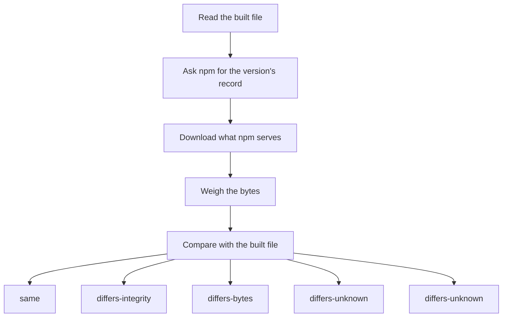

# The release route: plan and verify inside a flowchart

Part of [RELEASE-ROUTE.md](RELEASE-ROUTE.md). The code is `src/release-route/chart/`.

**Why.** The release flow is built with footprintjs so that the cause of a release that went
wrong is found with the library's own tools (the run record, the walk back from a value to what
decided it) and not by reading logs. The decision was already data (the ordered rule table of
`rules.mjs`); now it runs inside a chart, and every run saves its record.

## Which path runs, and what stays plain

The workflow runs the two deciding steps from the committed bundle:

```
node scripts/release-route-chart.mjs plan          # same inputs, outputs and exit codes as the plain plan
node scripts/release-route-chart.mjs verify        # same as the plain verify
node scripts/release-route-chart.mjs why <record file> [key]
```

`scripts/release-route-chart.mjs` is a plain file: it checks that `dist/release-route.cjs` is the
file `dist/release-route-metadata.json` names (sha256) and loads it; anything else is the refusal
`bundle-unloadable`, exit 1. `node dist/release-route.cjs <step>` runs the same bundle without that
check. The bundle is built by `npm run build` from `bin/release-route.mjs` with footprintjs and
foottrace inside it (no import but `node:`), and CI rebuilds it and compares it with the commit.

What the digest check does: it refuses a bundle cut short, damaged or missing after checkout. It is
not a defence against someone who can write to the checkout: the metadata sits beside the bundle
and can be changed with it, and the file is read a second time when it is loaded. What makes the
bundle the reviewed code is the review of the commit and CI's check that the committed bundle
equals a rebuild.

`node scripts/release-route.mjs plan` and `verify` stay as they were, and the workflow never falls
back to them (RELEASE-ROUTE.md, W14): they leave no record. They are the oracle the charted steps
are tested against, and a way for a person, outside the workflow, to read a failure.
`same-as-plain-plan.test.mjs` (38 inputs reaching all 20 rows of the table; no input reaches
`no-rule-matched`, since the table answers every combination of readable facts and
`facts-unreadable` answers the rest, so `decision.test.mjs` reaches it with a stand-in stage) and `same-as-plain-verify.test.mjs` (9 answers from npm) run both paths on the
same inputs and compare the exit code, every printed line, `GITHUB_OUTPUT` and the job summary; the
only lines the charted path adds are its `Story:` and `Record:` lines.

**What stays plain, on purpose.** `build`, `inspect`, `ready`, `tag`, `notes` and `npm-tool` stay
plain Node files with no engine, because `ready` and `inspect` run in the job that holds the right
to publish, and the least code runs beside that right. They take no decision a reader needs to walk
back: each is one check whose refusal already names what it found.

## The plan chart

Read the request; then, side by side, the tip of `main`, the tool commit, the settings and
`package.json`; gather; then, side by side, the tag, npm and the changelog (they need the name and
the version); gather; weigh; decide. Each stage calls the same reader of `observe.mjs` the plain step
calls, through the same doors (git, fetch, the environment), and writes its facts under the names of
`rules.mjs`. The doors are bound when the chart is built and never enter its state.

```mermaid
flowchart TD
request["Read the request"]
request --> look_tip
look_tip["Look at the tip of main"]
request --> look_tool
look_tool["Look at the tool commit"]
request --> look_settings
look_settings["Read the settings"]
request --> look_package
look_package["Read package.json"]
request --> gather_first
gather_first["Gather what was seen"]
gather_first --> look_tag
look_tag["Look for the tag"]
gather_first --> look_npm
look_npm["Ask npm"]
gather_first --> look_changelog
look_changelog["Read the changelog"]
gather_first --> gather_second
gather_second["Gather what was seen"]
gather_second --> weigh
weigh["Weigh the facts"]
weigh --> decide
decide["Decide by the rule table"]
decide --> tool_commit_invalid
tool_commit_invalid["Rule tool-commit-invalid"]
decide --> tool_not_reviewed
tool_not_reviewed["Rule tool-not-reviewed"]
decide --> package_unnamed
package_unnamed["Rule package-unnamed"]
decide --> package_private
package_private["Rule package-private"]
decide --> version_not_plain
version_not_plain["Rule version-not-plain"]
decide --> package_unknown
package_unknown["Rule package-unknown"]
decide --> facts_unreadable
facts_unreadable["Rule facts-unreadable"]
decide --> released
released["Rule released"]
decide --> dry_run_released
dry_run_released["Rule dry-run-released"]
decide --> tag_without_package
tag_without_package["Rule tag-without-package"]
decide --> not_main_tip
not_main_tip["Rule not-main-tip"]
decide --> unfinished_not_tip
unfinished_not_tip["Rule unfinished-not-tip"]
decide --> changelog_missing
changelog_missing["Rule changelog-missing"]
decide --> recover_off_main
recover_off_main["Rule recover-off-main"]
decide --> recover
recover["Rule recover"]
decide --> dry_run_recover
dry_run_recover["Rule dry-run-recover"]
decide --> version_not_newer
version_not_newer["Rule version-not-newer"]
decide --> publish_off_main
publish_off_main["Rule publish-off-main"]
decide --> publish
publish["Rule publish"]
decide --> dry_run_would_publish
dry_run_would_publish["Rule dry-run-would-publish"]
decide --> no_rule_matched
no_rule_matched["Rule no-rule-matched"]
decide --> default
default["Rule no-rule-matched"]
```

<!-- plan-drawing -->

<!-- /plan-drawing -->

The drawing is the library's (`chart.toMermaid()`): a fork is drawn as edges from the stage before
it to each child and to the stage after it. The `default` box is the library's drawing of
`setDefault('no-rule-matched')`, the same branch as the box above it.

<!-- plan-stages -->
| Stage id | Name | Description |
|---|---|---|
| `request` | Read the request | The action, the ref, the tool commit and the commit to plan for |
| `look-tip` | Look at the tip of main | Is the planned commit the tip of origin main? |
| `look-tool` | Look at the tool commit | Is the release tool commit on footprintjs/ci main? |
| `look-settings` | Read the settings | Is .github/release.json at the commit readable and valid? |
| `look-package` | Read package.json | The package name, private flag and version at the commit |
| `gather-first` | Gather what was seen | Lift the facts the looks found side by side to their names |
| `look-tag` | Look for the tag | Does origin have tag v<version>? |
| `look-npm` | Ask npm | Does npm know the package, have the version, and is the version newer? |
| `look-changelog` | Read the changelog | Has CHANGELOG.md a section for the version? |
| `gather-second` | Gather what was seen | Lift the facts the looks found side by side to their names |
| `weigh` | Weigh the facts | Every fact by name, and whether each was read |
| `decide` | Decide by the rule table | The first row of rules.mjs whose facts all match decides |
<!-- /plan-stages -->

Each result branch (`Rule <id>`) writes `rule`, and either `mode` and `compare` or `refusal`.

**The decision reads exactly what the plain path decides on.** A fact enters state as its
observer's value when that value is one of the fact's values in `rules.mjs`, and as `null`
otherwise; it is never cleaned into a value (`state.mjs`). The action is outside text: `"publish "`
with a space, or with a hidden character, is not `publish`; on both paths it is unreadable, with
the cause `input-invalid` (`ROUTE_ACTION`), and the plan refuses (`facts-unreadable`).

Side by side, each look writes under `runs/<stage id>/` (the library's rule for a fork, so siblings
cannot overwrite each other); the gather stage lifts those facts to their names. A fact that could
not be read is `null`, and its cause (`{ code, detail }`, a refusal code of THE table and its
cleaned detail) is under `causes.<fact>`. A look that throws (a fault, not a fact it could not
read: those are causes) stops the run (`failFast`), and the step refuses with that fault.

### The decision: `decide()` over the rule table, unchanged

`stages/decide.mjs` hands `RULES` to footprintjs's `decide()`: each row becomes one rule whose
filter is the row's equality tests (`{ fact: { eq: value } }`), whose label is the row's id and
whose branch is the row's id; `decide()` takes the first rule that matches, as `plan.mjs` does. No
rule matching is the default branch, `no-rule-matched`. `decide()` expressed every row exactly; no
row was changed. `decide()` numbers its rules from 0 in its story ("Rule 7 "released""); the table
in RELEASE-ROUTE.md numbers them from 1.

The agreement test runs one decision chart (the weigh and decide stages, seeded with the facts)
against `plan.mjs` on every combination `plan.test.mjs` enumerates (8,192), and on each
combination with one fact made unreadable as `null`, `undefined`, a string and a number
(`test/release-route/chart/agreement-*.test.mjs`): the same rule, mode, compare and refusal every
time.

## The verify chart

<!-- verify-drawing -->

<!-- /verify-drawing -->

<!-- verify-stages -->
| Stage id | Name | Description |
|---|---|---|
| `built` | Read the built file | The integrity and size of package.tgz |
| `ask-npm` | Ask npm for the version's record | Wait a bounded time for npm to show the version; its integrity and tarball address |
| `download` | Download what npm serves | The integrity of the tarball npm hands out |
| `weigh-bytes` | Weigh the bytes | Is npm's integrity, and are the bytes it serves, the built file's? |
| `compare` | Compare with the built file | The first rule that matches decides |
<!-- /verify-stages -->

The compare rules, in the order the plain step checks them: npm records another integrity →
`registry-differs` (`differsBy: integrity`); npm serves other bytes → `registry-differs`
(`differsBy: tarball bytes`); both equal → verified. The download runs only when npm's recorded
integrity is the built file's. `looks` counts how many times npm was asked; a version npm never
shows ends in `registry-late` after the last look is written, so the record says how long it waited.

## The record

With `ROUTE_RECORD_DIR` set (an absolute path; a fresh folder under the runner's temp folder),
each charted step writes one file there: `plan.record.json` or `verify.record.json` (mode 0600,
never over an existing file, at most 8 MiB). Absent, nothing is saved and the step still decides.

| Field | What it holds |
|---|---|
| `format`, `version` | `footprintjs-ci/release-route-record`, `1` |
| `step`, `runId` | `plan` or `verify`; the library's run id |
| `library` | the bundled footprintjs and foottrace versions |
| `chart` | the chart as drawn (`toMermaid()`) |
| `state`, `initialState` | the state the run ended with, and the one it began with |
| `commitLog` | every stage's writes, with the keys it read before each write |
| `executionTree` | every stage's reads |
| `control` | the decisions with `decide()`'s evidence, and which decision let which stage run |
| `story` | the library's narrative, at most 400 entries of `{ type, depth, text }` |
| `failure` | `null`, or the refusal code and detail that stopped the run |

What it never holds: the token (it stays inside the doors), the environment, or a path of the
runner. Every fact is `true`, `false` or `null`; the action is cut to 40 characters and cleaned;
the commit, name, version and changelog style are kept only when each has its exact shape; a
cause's detail is cut to 120 characters and cleaned. `steps.test.mjs` runs a plan with a
recognisable token (which does reach GitHub, through its door) and searches the saved file for
it, for the name `GITHUB_TOKEN`, and for the temp, home, working and record folders.

Why a snapshot file and not the library's record sink (`fileSink`): footprintjs 12.1.0's sink does
not declare what it collects (`opened.collects`), so foottrace's `readRunEvidence` reads every
decision channel as not collected from it, and the decision's evidence would be lost.

## The reader: `why`

`node scripts/release-route-chart.mjs why <record file> [key]` prints, from the file alone and with
no network, why a top-level key (default: `mode`, else `refusal`, else `verified`) has its value:
the decision that governs it (the decision whose branch let the key's last writer run, from the
record's control edges) with the rule that matched and each fact the rule tested, its value and the
stage that observed it; or, for a key no decision governs, one line saying so, no rule, and one
line naming the stage. That line says `Observed by` only for what a look observed: a fact of the
rule table or a context value (the commit, the package name, the version, the changelog style),
for example `Observed by Look at the tip of main (look-tip#1).` Every other key (a computed value
such as `factsReadable` or `servedEqual`, or the `runs` container) says `Written by`, naming the
stage that wrote it last. The stage that observed a fact is the one that wrote it into the record,
foottrace's `findLastWriter` on the look's own path. Then each unreadable fact with its cause, then the walk back. Every walk is foottrace's
(`findLastWriter`, `causalChain` with the control edges the record kept, `formatCausalChain`,
`keysReadFromExecutionTree`); `why.mjs` only arranges the answers into lines. Every line is
cleaned and starts with a fixed word, so no line can start a workflow command. A file that is not
a record of this shape is `record-unreadable`; a key that is not a plain name is `input-invalid`.

From the recorded storydeck case (`why.test.mjs`), cut short:

```
Why mode = "nothing" in the plan record of run 1794509344113-0000000001.
Decision at decide#11: rule released matched.
Fact tagExists eq true: was true, holds; observed by Look for the tag (look-tag#6).
Fact npmHasVersion eq true: was true, holds; observed by Ask npm (look-npm#7).
Fact action eq "publish": was "publish", holds; observed by Read the request (request#0).
Walk back (foottrace causalChain, with the decision edges the run recorded; each ". " is one step back):
Note: steps that ran side by side may be shown one under another in the walk; the "observed by" line says which step observed the fact.
Walk: Rule released (released#12) [wrote: rule, mode, compare]
Walk: . Decide by the rule table (decide#11) ← [control: released]
Walk: . . Read the request (request#0) ← via toolCommitPlain [wrote: action, refIsMain, toolCommitPlain, commit]
...
```

## What the record cannot show yet

Steps that ran side by side may be shown one under another in the walk; the "observed by" line says
which step observed the fact. This holds for footprintjs 12.1.0 with foottrace 1.15.0: foottrace's
`causalChain` reads a fork's `runs` namespace as one key, so looks that ran side by side appear
built on each other. It is being fixed in the library; until then `why` prints this sentence, in
the same words, directly above every walk, and draws nothing of its own.

## It fails closed

| What goes wrong | What the step does |
|---|---|
| A stage throws (a fault) | every stage function passes through `stage.mjs · stageFn`: what it throws leaves it as a refusal with only its code and its shown detail (no raw message reaches the record); the run stops (`failFast` in the forks); the step refuses with it, exit 1; the engine's logger is silent (`QUIET_LOGGER`), so nothing goes to stderr |
| A malformed `GITHUB_SHA` | `input-invalid` in the first stage, before anything is read, exit 1 |
| No rule matches | the default branch `no-rule-matched`, exit 1, no `mode` written |
| A state that holds a mode and a refusal | the refusal wins, exit 1 |
| The record cannot be written (relative path, not a folder, a link, a file already there, a failed write, over its bound) | the decision is printed first; a pass ends in `record-unwritten`, exit 1 (a release with no record is not what this route promises), and `GITHUB_OUTPUT` holds no `mode` and no `compare` (a step that exits 1 never tells a later job to act: the order of `report.mjs · end`, in `RELEASE-ROUTE.md`); a refusal stays that refusal, exit 1, with the line `Record: not saved (record-unwritten); the decision below stands.` |
| The job summary or `GITHUB_OUTPUT` cannot be written | exit 1; the summary is written first and every output in one append after it, `mode` last: a failing summary write, or an append that fails before writing, leaves no output at all, and an append that fails part-way is cut back, so the file is left as it was (what is left, two failures of the same file, is in `RELEASE-ROUTE.md`); the refusal goes to the log only |
| stdout is closed (`why … \| head`) | exit 1, nothing on stderr, no output written after the failed write (`stdout.mjs`) |
| The bundle is missing, changed or will not load | `bundle-unloadable`, exit 1 (through `scripts/release-route-chart.mjs`) |
| A record the reader cannot read (missing, not a regular file such as `/dev/zero` or a FIFO, a folder, over the bound, not strict JSON, another shape) | `record-unreadable`, exit 1, before a byte is read when the file is not a regular file within the bound |

## What the library did not do for us

1. **The record sink does not declare what it collects.** footprintjs 12.1.0's `fileSink` writes
   no `opened.collects`, so foottrace's `readRunEvidence` answers `not-collected` for every
   decision channel. The record is the snapshot plus the control recorder's snapshot instead.
2. **A fork's `runs` namespace is one key for `causalChain`.** Sibling looks show "built on runs"
   edges to each other; `edgeAttribution: 'per-write'` does not separate them. `why` adds exact
   "observed by" lines from `findLastWriter` on each look's own path.
3. **No reader rebuilds the control lookup from a saved `controlDepRecorder` snapshot.** `why`
   reads `control.controlDeps` itself and hands `causalChain` a function over it.
4. **A fork's writes need a gather stage** to reach their names; a decider cannot read
   `runs/<id>/<fact>` by the fact's name.
5. **`sliceForKey` has no control edges**, so `why` uses `causalChain`, which takes them.
6. **`toMermaid()` draws `setDefault(id)` as a second box** named `default` beside the branch it
   names.
7. **The engine records a thrown value's raw text** (the execution tree's
   `errors.stageExecutionError` and the story's error line), unbounded and uncleaned. The route
   wraps every stage function (`stage.mjs · stageFn`) so only a refusal's code and shown detail
   can be thrown into it.
8. **The logger is a chart property, not an executor option.** footprintjs 12.1.0's default logger
   writes a stage error with its stack (and the checkout's paths) to stderr; the only door is
   `FlowChartBuilder · setLogger`, which each chart calls with a silent logger.
